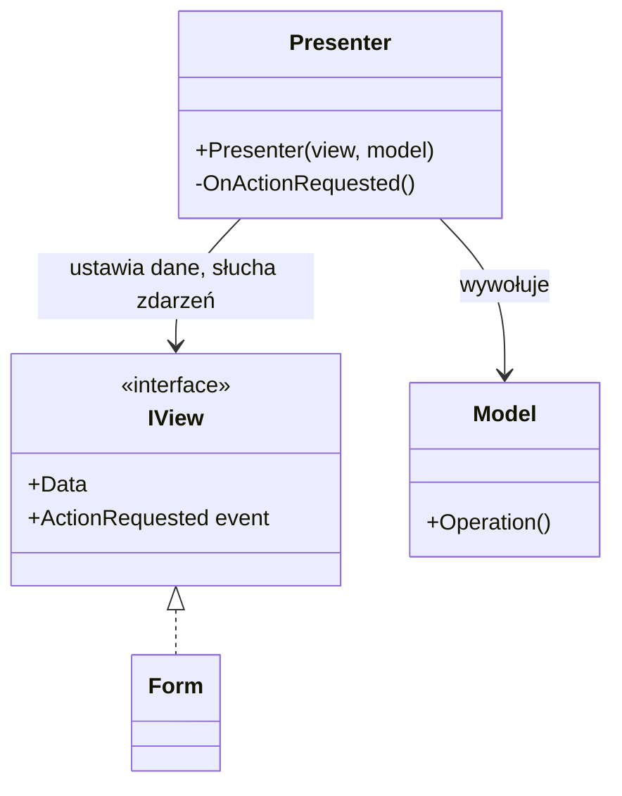
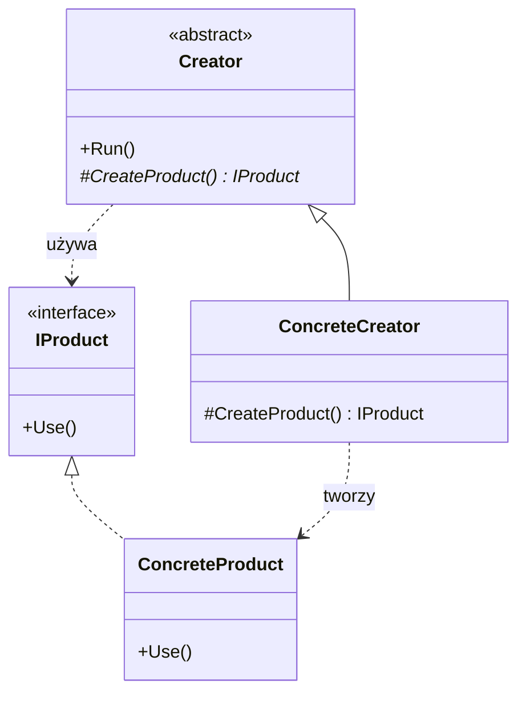
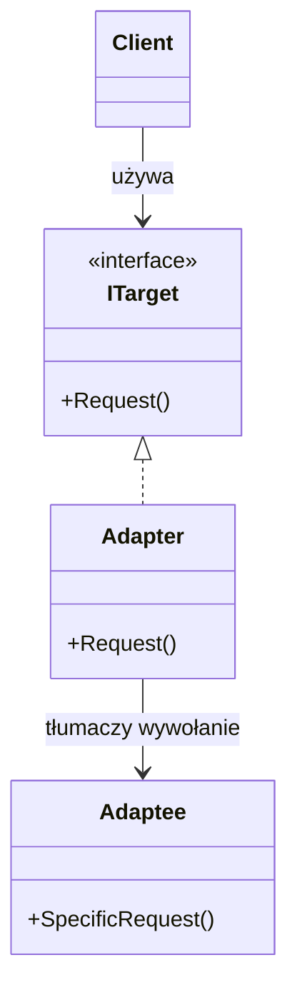
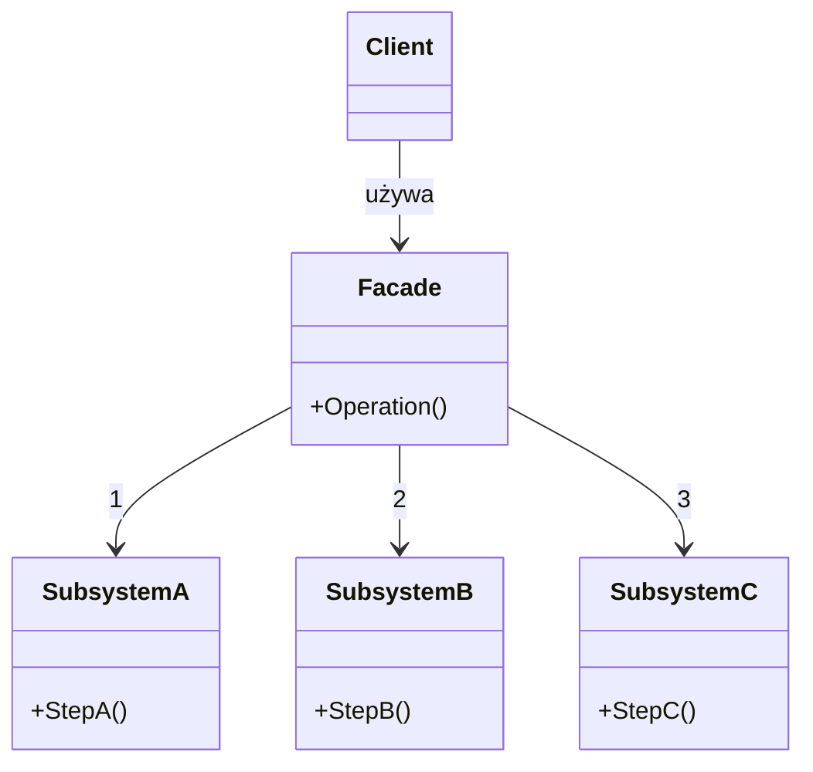
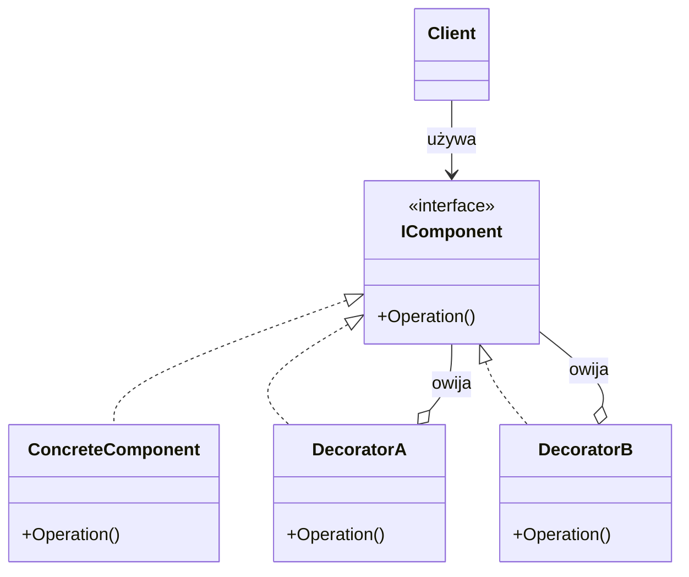
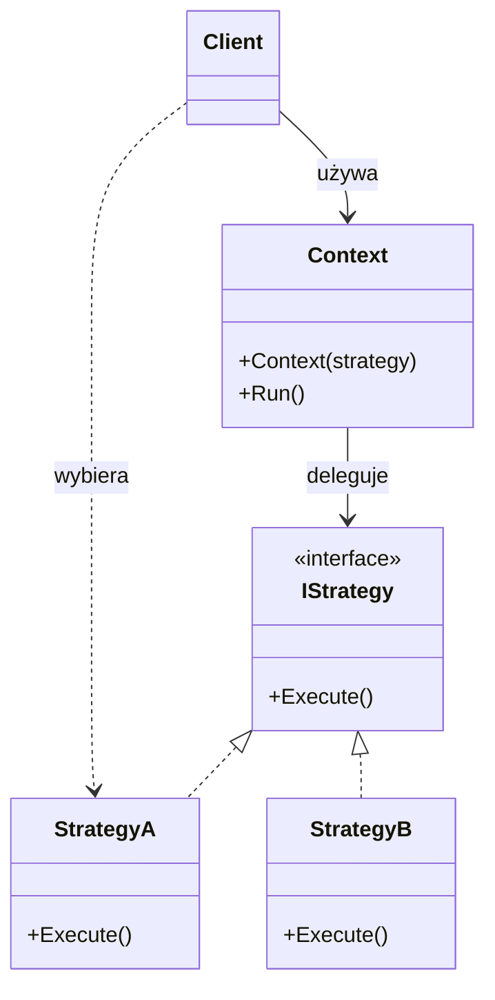
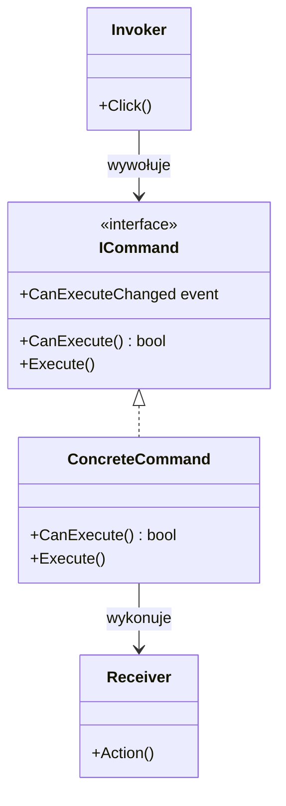
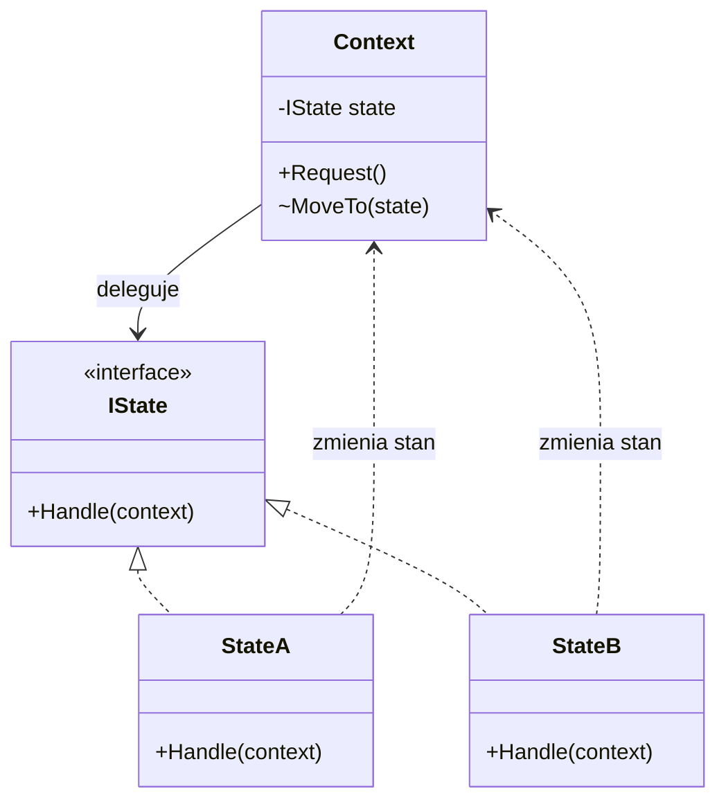
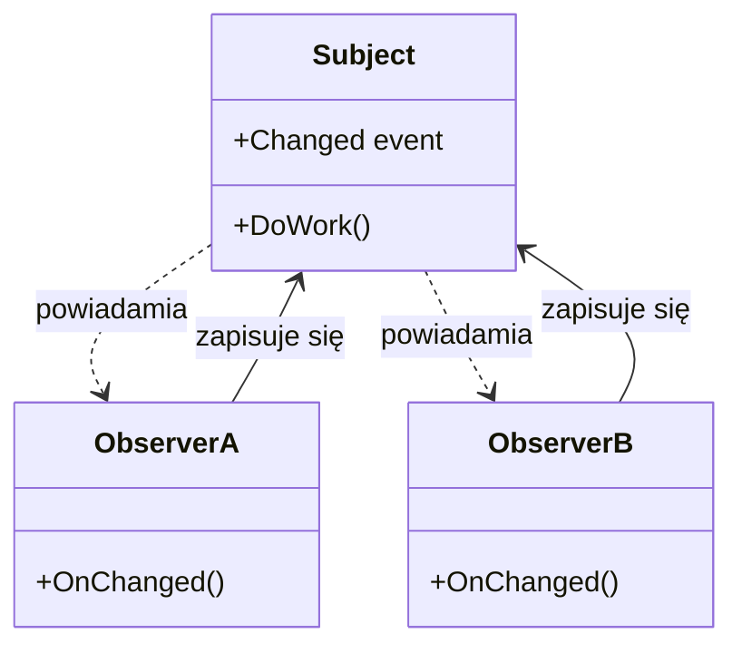
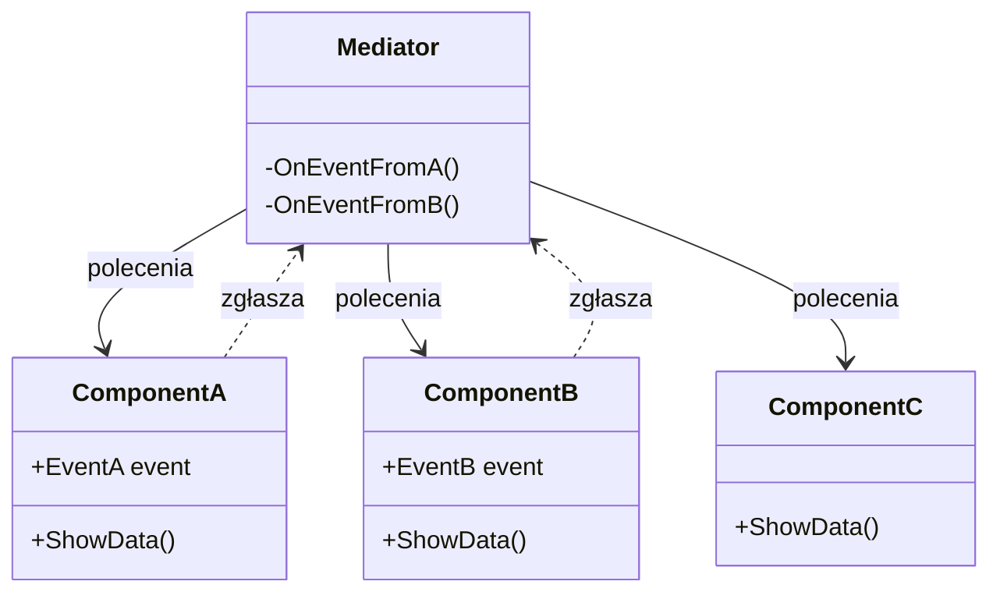

# Diagramy wzorców projektowych

Każdy diagram pokazuje role we wzorcu, a nie konkretne klasy z przykładów. Na GitHubie diagramy wyświetlają się automatycznie.

| Wzorzec | Dzień | Kiedy pomaga |
|---|---|---|
| [Model-View-Presenter](#model-view-presenter) | 2 | Logikę ekranu trzeba testować bez okna |
| [Factory Method](#factory-method) | 2 | Przebieg jest wspólny, a różni się tworzony obiekt |
| [Adapter](#adapter) | 2 | Obcy kod ma inny interfejs, niż potrzebuje aplikacja |
| [Facade](#facade) | 2 | Jedna operacja wymaga wielu kroków w kilku podsystemach |
| [Decorator](#decorator) | 2 | Do obiektu trzeba dołożyć działanie bez zmiany jego kodu |
| [Strategy](#strategy) | 3 | Sposób działania wybiera się spośród kilku wariantów |
| [Command](#command) | 3 | Operację wywołuje się z wielu miejsc lub trzeba nią zarządzać |
| [State](#state) | 3 | Zachowanie obiektu zależy od jego stanu |
| [Observer](#observer) | 3 | Nadawca ogłasza zmianę, nie znając odbiorców |
| [Mediator](#mediator) | 3 | Wiele komponentów musi współdziałać bez wzajemnych zależności |

## Model-View-Presenter

Widok pokazuje dane i zgłasza działania użytkownika, a Presenter decyduje, co z tego wynika. Dzięki interfejsowi Presenter można testować bez formularza.

## Factory Method

Twórca zna przebieg pracy, a decyzję, który produkt powstanie, zostawia klasom pochodnym.

## Adapter

Aplikacja definiuje potrzebny interfejs, a adapter tłumaczy go na wywołania obcego kodu.

## Facade

Fasada daje jedną prostą operację i zna kolejność kroków. Podsystemy o niej nie wiedzą i nadal można ich używać bezpośrednio.

## Decorator

Dekorator ma ten sam interfejs co obiekt, który owija. Przekazuje mu wywołanie i dokłada jedno działanie, a dekoratory można układać w łańcuch.

## Strategy

Kontekst zna tylko interfejs strategii i nie sprawdza, z którym wariantem pracuje. Wariant wybiera ktoś z zewnątrz.

## Command

Polecenie to operacja zapisana jako obiekt. Przycisk, menu i skrót korzystają z tego samego polecenia i nie znają szczegółów operacji.

## State

Kontekst przekazuje operacje do bieżącego stanu, a stan decyduje, czy operacja jest dozwolona i jaki stan będzie następny.

## Observer

Nadawca ogłasza, że coś się stało, a zainteresowani zapisują się sami. W C# rolę nadawcy i listy odbiorców zwykle pełni `event`.

## Mediator

Komponenty nie mają do siebie referencji. Zgłaszają, co się stało, a mediator decyduje, kto i w jakiej kolejności ma zareagować.

